# The three engines

Each of LabOps's three repositories has an engine: the program that holds its rules, makes every
change a button asks for, and writes every file that is generated rather than typed. The app never
edits a record itself; it asks the engine. Claude never edits a record by hand when a command does
it; it runs the same engine. This page explains how each engine works and how the app, Claude,
the commit hooks and GitHub use it. [How LabOps fits together](architecture.md) puts them in
context, and [What LabOps does](what-labops-does.md) describes the app around them.

| | Projects | Protocols | Quotes |
|---|---|---|---|
| Repository | [LabOps-Projects](https://github.com/uw-maccosslab/LabOps-Projects) | [LabOps-Protocols](https://github.com/uw-maccosslab/LabOps-Protocols) | [LabOps-Quotes](https://github.com/uw-maccosslab/LabOps-Quotes) |
| Engine | `LabOps.Engines` in this repository, and the `labops` tool | `scripts/protocol.py` | `scripts/quote.py` |
| Language | C# (.NET 10) | Python 3.13 | Python 3.13 |
| The app runs it | In its own process | `uv run --frozen python scripts/protocol.py --json ...` | `uv run --frozen python scripts/quote.py --json ...` |
| Claude, the hook and CI run it | `labops projects ...` | `uv run python scripts/protocol.py ...` | `uv run python scripts/quote.py ...` |
| Its tests | `src/LabOps.Tests` (xUnit) | `tests/` (pytest) | `tests/` (pytest) |
| A rule change reaches people | With a LabOps release | On their next sync | On their next sync |

## What every engine has in common

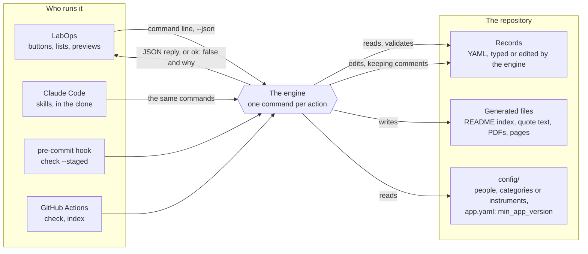

- **One command per action.** A button becomes one command line, such as
  `labops projects stage MNRF-BioTRACK plate_layout done --by jdoe`, the same line Claude would
  type. Every command takes `--json`; the reply is the result, or `{"ok": false, "error": "..."}`
  with the reason to show. Exit codes are 0 (done), 1 (refused, with a message) and 2 (the command
  line was wrong).
- **Records keep their comments.** The records are YAML that people and Claude also read and edit,
  with comments explaining each field. The engines change them line by line rather than rewriting
  them, so the comments and the order stay.
- **The rules run three times.** When a command makes a change; when anything is committed (the
  pre-commit hook runs `check --staged`, and the app runs it before its own commits); and on GitHub
  after every push (`check`, or `verify` against the commit before the push), which catches a change
  made without the hook.
- **The JSON is a contract.** The app reads what the engines print. The quotes' and protocols'
  `tests/test_contract.py` hold their side; LabOps's `src/LabOps.Tests/Fixtures/*.json`, recorded
  from the engines, hold the app's. A change to that JSON needs a matching app release and a higher
  `min_app_version`.
- **`min_app_version`** in each repository's `config/app.yaml` names the oldest LabOps allowed to
  change it. An older copy shows a banner, keeps working read-only, and offers its update.

## The projects engine

The projects engine was `scripts/project.py` in LabOps-Projects until October 2026, when it was
ported to C# and moved into this repository (`src/LabOps.Engines`, LabOps 26.10.0). It gives the
same answers the Python engine gave, byte for byte for every record it writes, which the tests hold
it to. It has no Python and no uv to install, it answers in milliseconds, and the app reads every
project in memory instead of starting a program for each list.

### Who runs it

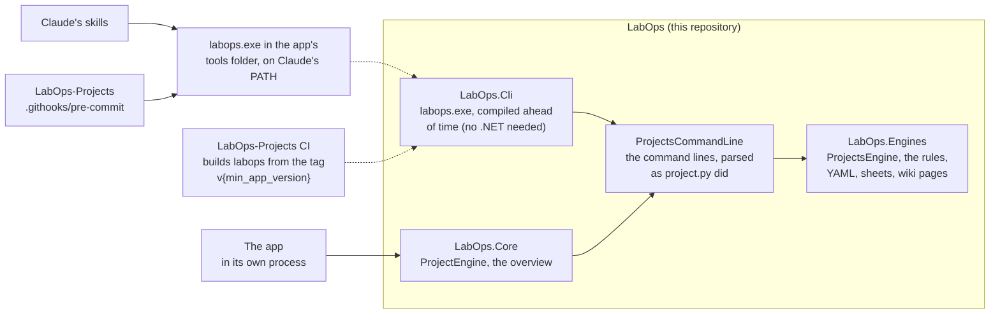

- The app builds the same command lines the `labops` tool takes and runs them in-process, so a
  button and the tool always mean the same thing.
- The installer puts `labops.exe` in the app's `tools` folder, which the app puts first on the
  PATH of every Claude conversation. The pre-commit hook looks for `labops` on the PATH, then in
  that folder.
- LabOps-Projects' GitHub Actions build `labops` from this repository at the tag its
  `min_app_version` names, so CI checks the records with the rules everyone's app has.

### What it keeps

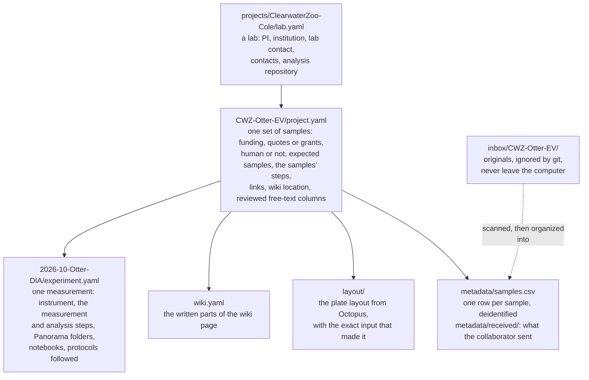

A step is a line under `steps:` with an id, a kind (one of eleven, such as `plate_layout` or
`data_acquisition`), a status (`pending`, `in_progress`, `done`, `skipped`), and the dates, people
and note that go with it: started, finished, by, assigned, and the planned start and finish. A new
project starts with the sample steps and a new experiment with the measurement steps; `add-step`
adds any kind anywhere (a second shipment, assay development, a second analysis).

The kinds fall into five phases, each with one color wherever a step is shown (defined in
`LabOps.Engines/Projects/Phases.cs`):

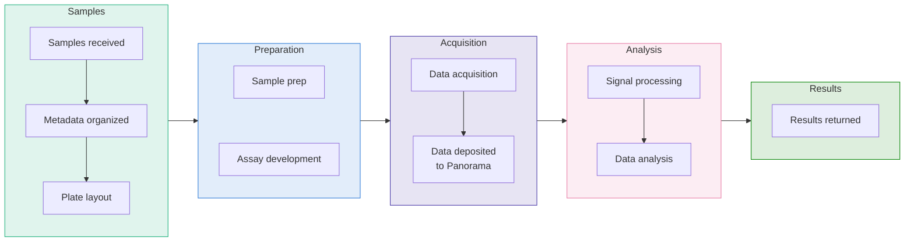

A step of kind `other` belongs to no phase and is gray. Status is never told by a hue: finished
work is gray, and late work has a red ring.

### Inside the engine

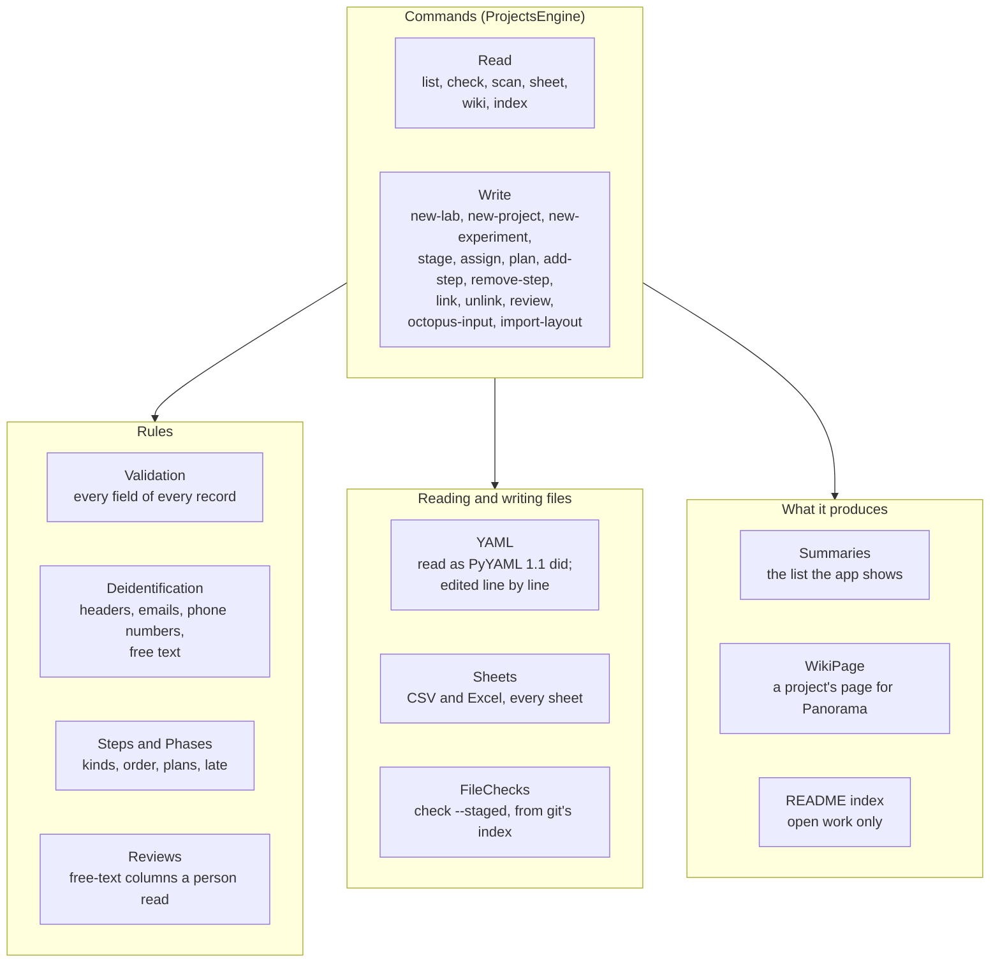

- **YAML as Python read it.** Records were written for PyYAML, which reads `yes` as true, `012` as
  octal and `2026-10-09` as a date. The engine types plain scalars the same way, and writes values
  quoted exactly as PyYAML would, so a record looks the same whichever engine last touched it.
- **Edits, not rewrites.** `stage`, `link` and the rest change only the lines they mean to,
  keeping every comment and the order of the fields.
- **Sheets.** `scan` and `sheet` read CSV and Excel files (`.xlsx`, `.xlsm`, every sheet, hidden
  ones too), with dates found from the cell's number format, as the Python engine did.

### Keeping identifiers out

LabOps-Projects holds only deidentified sample information. Git keeps whatever is committed, even
after a file is deleted, so the rule is enforced before anything is committed:

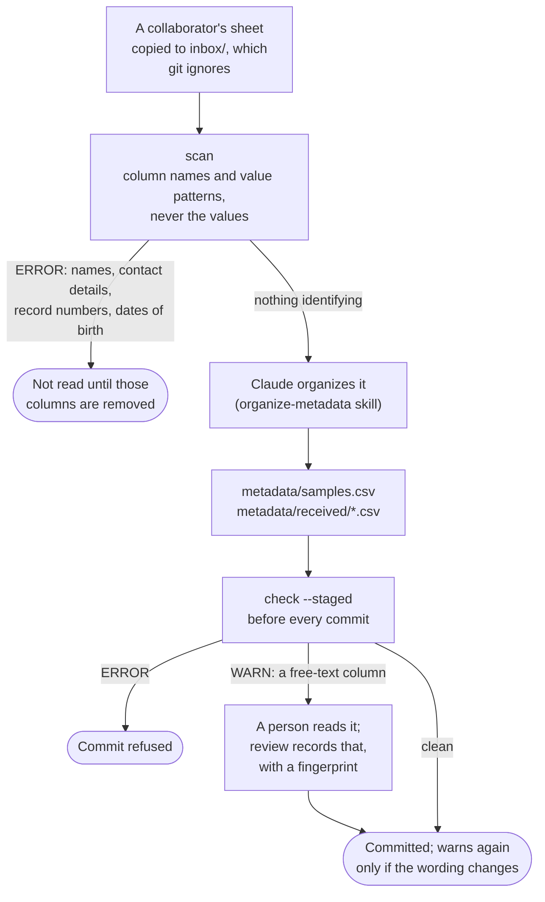

The app runs `check --staged` before each of its commits and tells the repository's hook which
staged tree it checked (`LABOPS_CHECKED_TREE`); the hook checks any other tree itself, including
every commit made at a terminal.

### Its tests

- `Fixtures/engine-golden/*.json`: what `project.py` did, as tables: about 10,000 YAML values as
  PyYAML wrote them, YAML and JSON as Python read them, the line edits, and the identifier rules on
  every header in LabOps-Projects' tests.
- `Engines/Commands`: LabOps-Projects' command tests, moved here when `project.py` was removed. Each
  makes a scratch repository and runs `labops projects` in-process.
- `Engines/ParityTests` (opt-in): both engines on the real repository and on a repository of edge
  cases, compared byte for byte. The wiki page's HTML is left out, since it now shows the phase
  colors `project.py` never drew.

### Changing a rule

A projects rule changes with the app: a change in `LabOps.Engines`, with a test and a release note,
ships in a LabOps release. Once it is out, LabOps-Projects raises `min_app_version` if the
repository needs it (for example, because its skills use a new command), and its CI starts checking
with that release's engine.

## The protocols engine

`scripts/protocol.py` in LabOps-Protocols. Everything about it serves one rule: **a published
version never changes**, because it is what someone followed at the bench, and a project records
which version it used.

### What it keeps

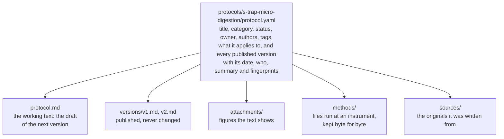

### From an upload to a published version

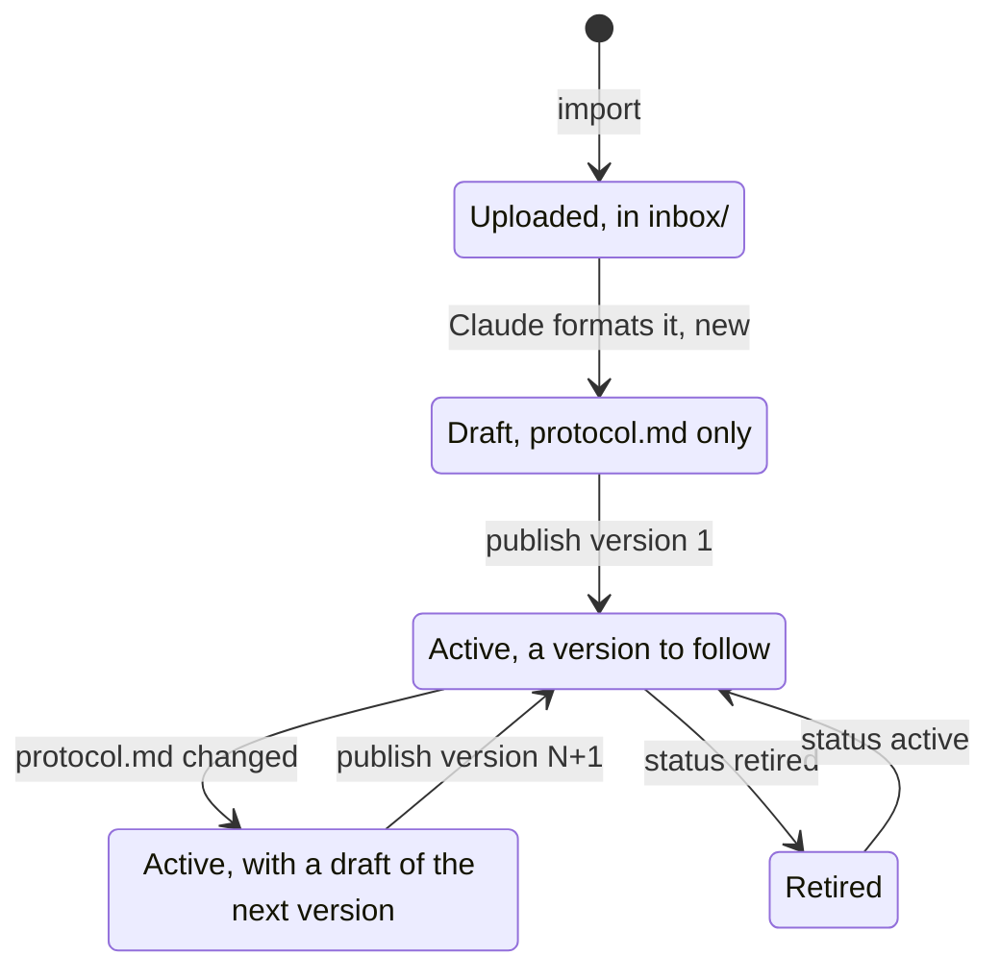

While a protocol is a draft or being revised, **Ask Claude to change it** and **Update from a file**
change `protocol.md`, never a published version.

- **`import`** copies the files into `inbox/<id>/` (ignored by git) and pulls the text and figures
  out of the documents into one `text.md`, each under its own header. Word colors and highlighting
  come through as `{yellow: ...}`, because old protocols used color for meaning. Method files (a
  KingFisher program) are kept, unread.
- **`publish`** copies `protocol.md` to `versions/v<N>.md` and records the version in
  `protocol.yaml`, with the fingerprints of its text, of the figures it shows and of the methods it
  links. Publishing is a person's decision, never Claude's.
- **`render`** draws a version (or the draft) as one printable HTML page with its figures inside
  it: what the app's preview shows and what Print opens.
- **`diff`** is Show changes: what changed from one version to another, or from the last one to the
  draft.
- **`check --staged`** (the pre-commit hook) and **`verify --base <commit>`** (CI after each push)
  refuse any change to a published version, its record, or a figure or method it uses.

### Changing a rule

A change to `protocol.py`, the templates, the config, the skills or `CLAUDE.md` reaches everyone on
their next sync. It gets a test under `tests/` and an entry in
`release-notes/RELEASE_NOTES_engine-next.md`; an engine release is tagged `engine-v{version}`.

## The quotes engine

`scripts/quote.py` in LabOps-Quotes, the private repository of the people who prepare quotes. It
prices a quote from the rate card, checks its design, and writes everything sent to a client.

### From a request to the PDF

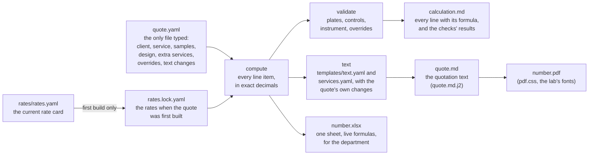

- **`build`** writes `calculation.md`, `quote.md` and a draft spreadsheet; **`pdf`** writes a draft
  PDF; **`check`** validates without writing. The drafts are not committed; `send` writes the final
  PDF and spreadsheet, which are.
- **Rates are locked.** The first build copies the rate card into the quote's `rates.lock.yaml`, so
  a later change to the rate card never reprices a quote. Re-pricing a draft means deleting the
  lock and building again.
- **The design rules:** a batch is one 96-well plate (study samples, controls and extra wells);
  controls default to 2 per 10 study samples; the instrument must be in the rate card. A quote that
  breaks one says so in `calculation.md`, and the build warns.
- **`sow`** writes a statement of work at several sample counts, in the same style.

### A quote's life

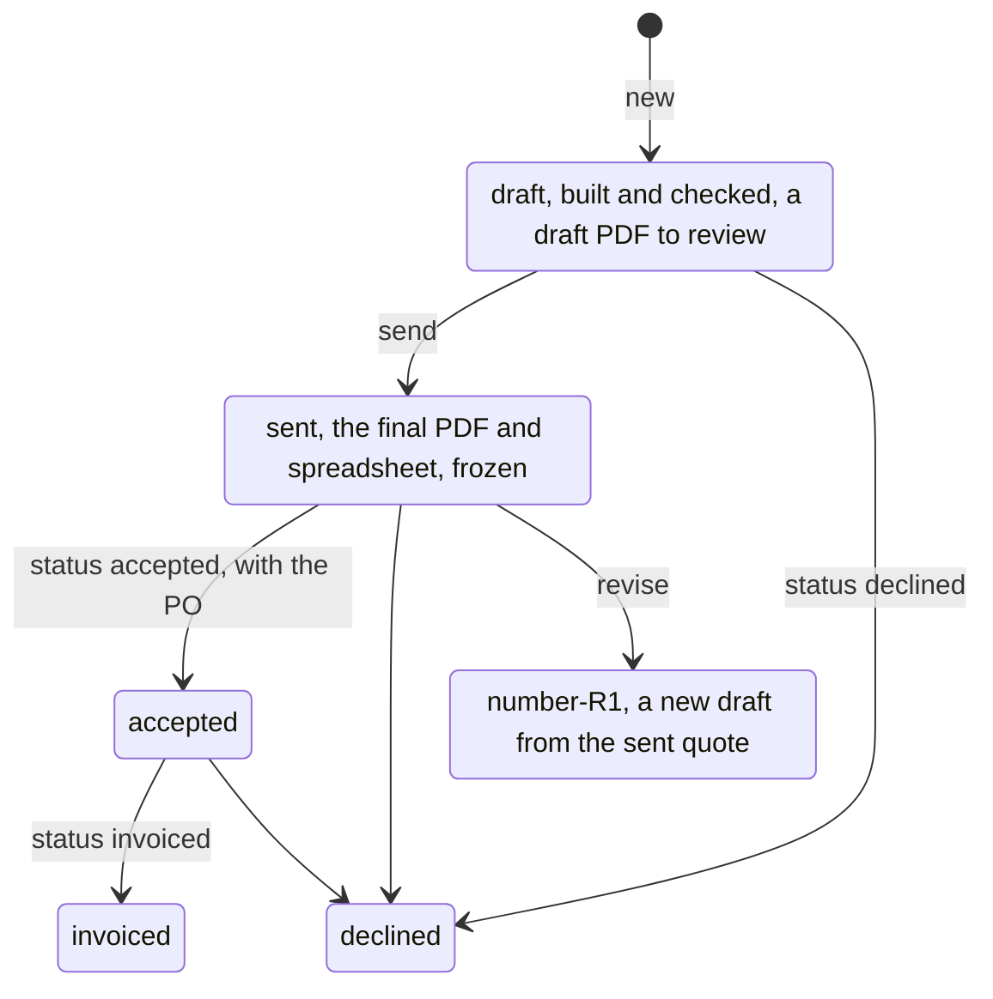

- **Sent quotes are frozen.** `send` writes the PDF that went to the client, and nothing
  regenerates it; `verify` (CI after each push) rejects any change to a sent quote, and any change
  of status that `send` or `status` did not make.
- **Statuses only move forward**, each with its date: draft, sent, accepted (purchase order
  received), invoiced; a quote can be declined at any point before it is invoiced. A change after
  sending is a revision, a new quote that starts from the old one.
- **Historical estimates** were imported from the lab's old cost workbook; `verify` holds each to
  the amounts in its tab.

### Changing a rule

As for the protocols: a change to `quote.py`, the templates or the rate card reaches everyone on
their next sync, with a test and an engine release note. Each quote keeps the rates it was built
with, so a new rate applies only to quotes built after it.

## How a change to a rule reaches people

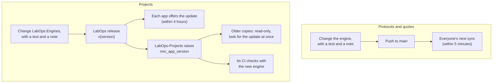

The Python engines change by syncing, so a new rule can arrive before the app that understands a
new reply; `min_app_version` covers that case too. The projects engine changes only with the app,
so everyone with the same app version has the same rules.
