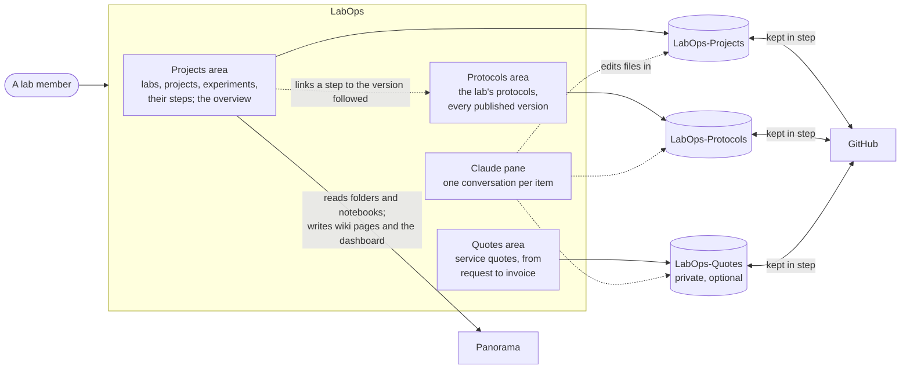

# What LabOps does

LabOps is the MacCoss Lab's desktop app for running its proteomics work: tracking each
collaboration's samples from arrival to results, keeping the lab's protocols, and preparing quotes
for outside collaborators. It has three areas, one for each, and each area works on its own git
repository on GitHub. Claude Code works inside the app to do the paperwork, and the app saves and
shares every change.

The Projects and Protocols areas are for the whole lab. The Quotes area appears only for the people
who prepare quotes, because only they can open LabOps-Quotes.

## The Projects area

A **lab** is a collaborator's group (or the lab's own work, `UW-MacCoss`). A **project** is one set
of samples, with its funding, its sample table and the steps that get the samples ready. An
**experiment** is one measurement of a project's samples, on one instrument, with the steps from
acquisition to results. A project can have several experiments: a discovery run, then a targeted
assay.

### The list and a project's page

The **List** shows the open projects with their lab, where each stands (the first step not yet
done, with its phase's color), who has that step, and when anything in it last changed. Selecting
one shows its page: the samples' timeline, then each experiment's.

Each step has buttons for what can be done with it:

| Button | What it does |
|---|---|
| **Start**, **Done**, **Skip**, **Reopen** | Records the step's progress, with a date, who, and a note |
| **Assign** | Gives the step to a lab member |
| **Plan** | Sets when the step should start and finish; the overview shows the plan, and the step as late once it passes |
| **Add a step**, **Remove** | Adds a step of any kind anywhere (a second shipment, a second analysis); removes one added by mistake |

And some steps have the tools for their work:

| On the step | Tool | What it does |
|---|---|---|
| Metadata organized | **Organize with Claude**, **View samples** | Scans a collaborator's sheet for identifiers, then has Claude build the sample table; shows the table |
| Plate layout | **Open in Octopus**, **Import layout** | Writes the input for Octopus, the plate layout tool; keeps the layout it exports |
| Sample prep, and the bench steps | **Add protocol**, **Add notebook** | Records the protocol version followed, and the ELN notebook |
| Data deposited, data acquisition | **Add raw data folder**, **Add process control folder** | Records where the raw files and the system suitability runs are on Panorama |
| Signal processing | **Add results folder** | Records the Panorama folder with the Skyline documents |

Above the timelines: **Ask Claude to update it** (a conversation about this project),
**New experiment**, **Wiki page** (the project's page on Panorama), **Folder** and **On GitHub**.
**New project** is in the toolbar.

### The overview

**Overview** shows everyone's open work, or one person's, in every lab or one:

| View | What it shows |
|---|---|
| **Needs attention** | Steps that are late, steps due or starting in the next 7 days, and records with errors |
| **Board** | Every open project and experiment, in a column for the phase of its current step |
| **Timeline** | Each item's steps on a line across twelve weeks: what happened, solid; what is planned, dashed; today, a line |
| **Calendar** | A month, with each day's steps started, finished, planned to start, or due |
| **Instruments** | Each mass spectrometer's acquisitions on the timeline's weeks, and any that overlap |

Each phase of the work has one color, the same in every view, on the step rows, on the lab
dashboard and on the wiki pages: Samples aqua, Preparation blue, Acquisition violet, Analysis pink,
Results green. Finished work is gray, and late work has a red ring. Clicking an item in any view
shows it in the list.

**Publish to Panorama** puts a summary of every lab's open work (what needs attention, the work in
each phase, the instruments' coming weeks) on a page in the Panorama folder LabOps-Projects
names, which the app then keeps up to date. That folder should be readable by lab members only;
LabOps does not check its permissions.

## The Protocols area

The lab's protocols, each in one standard format, with every version ever published. Search by
title, tag, sample type, instrument or owner; filter by category; **Show retired** includes the
retired ones.

Selecting a protocol shows its page: the current version, or any earlier one from **Showing**, or
the draft of the next. Its buttons:

| Button | What it does |
|---|---|
| **New protocol** (toolbar) | Starts one from a Word, PDF, LaTeX or text file (or several, with method files), which Claude puts in the lab's format; or from nothing |
| **Ask Claude to change it** | A conversation that edits the draft |
| **Update from a file** | Has Claude bring the draft in line with a newer original |
| **Show changes** | What changed from the last published version to the draft, or between versions |
| **Publish version N** | Makes the draft a version, with a summary of what changed; it never changes after that |
| **Retire**, **Make active** | Takes a protocol out of use, or brings it back; protocols are never deleted |
| **Print** | Opens the page in the browser, to print |
| **Folder**, **On GitHub** | Opens the protocol's folder on this computer, or its page on GitHub |

A project's step records the exact version it followed, and its link opens that version here.

## The Quotes area

Quotes for MacCoss Lab Proteomics Services, from a request to the invoice. Selecting one shows the
quote as the client will read it, or **Show the calculation** with every line and formula.

| Button | What it does |
|---|---|
| **New quote** (toolbar) | Claude drafts one from a request: a form, a pasted email, or an email thread |
| **Ask Claude to change it** | A conversation that changes the draft |
| **Draft PDF** | The PDF as it would be sent, to review |
| **Send** | Freezes the quote: the final PDF for the client and the spreadsheet for the department (for the people allowed to send) |
| **PO received**, **Invoiced**, **Declined** | Records where it stands, with the date |
| **Make a revision** | Starts a revised quote from a sent one |
| **Statement of work** | The contract's scope and prices at several sample counts |
| **Open PDF**, **Spreadsheet** | The files that were sent |
| **Folder**, **On GitHub** | Opens the quote's folder on this computer, or its page on GitHub |

## Claude in the app

Every **Ask Claude**, **New project**, **New protocol**, **New quote** and **Organize with Claude**
opens a conversation in the pane beside the item. Claude works in the repository's folder and
follows its instructions (`CLAUDE.md` and the skills in `.claude/skills/`). It reads and edits
files and runs the repository's engine, and asks before anything else. It never commits or pushes:
when it finishes a turn, the app checks what changed, commits it, shares it, and says so. Each
item keeps its conversation, so it can be continued later.

## Keeping everyone in step

Each person works on their own copy (clone) of each repository. The app commits each change on the
computer at once, then shares it with GitHub in the background, and brings in everyone else's
changes every 5 minutes. **Sync now** does that at once; **Reload** re-reads the copies on the
computer without contacting GitHub. Two people working on different items never conflict, because
each item has its own folder. [How it works, step by step](flows.md) shows what happens when they
do.

## Panorama

LabOps reads Panorama to choose an experiment's folders and notebooks, and to count the Skyline
documents in them, signed in the way PanoramaBridge is. It writes two kinds of page: each project's
wiki page, which the collaborators of that project read, and the lab dashboard. Each is read by
whoever can open its Panorama folder; LabOps does not change those permissions.

## Updates

LabOps updates itself from this repository's releases. It looks for a new one every 4 hours,
downloads it in the background, and shows **Update ready: restart to install**; it never restarts
on its own. A repository can require a newer app (its `config/app.yaml` names the oldest it
accepts): an older copy then says so in a banner, shows everything but changes nothing, looks for
the update at once, and offers **Restart to update**.

## Who can see what

| What | Who |
|---|---|
| LabOps (this repository) | Public; it holds no lab data, and its examples are made up |
| LabOps-Projects, LabOps-Protocols | The lab; sample information there is deidentified |
| LabOps-Quotes | The people who prepare quotes |
| A project's wiki page on Panorama | Everyone who can open its Panorama folder, the collaborators included |
| The lab dashboard on Panorama | Everyone who can open the folder LabOps-Projects names for it, which should be lab members only |

Next: [How LabOps fits together](architecture.md) and [The three engines](engines.md).
